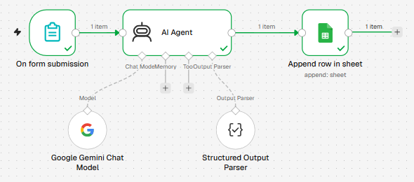
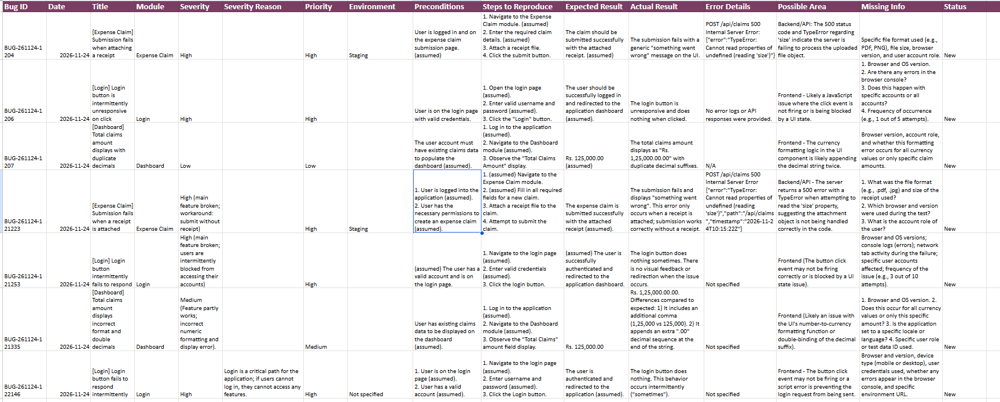

# AI Defect Drafting Agent (n8n + Gemini)

A no-code AI agent that turns a messy bug description or error log into a structured, developer-ready defect report. You paste what happened into a web form, and a few seconds later a complete bug report appears in a Google Sheet: title, severity, steps to reproduce, expected vs actual result, key error details, likely area of the code and the questions a developer would still ask.

**Built with:** n8n (Form Trigger + AI Agent) · Google Gemini (Flash model, free tier) · Google Sheets



---

## The problem

Bug reports often arrive as one-liners ("login does nothing sometimes") or as a pasted wall of logs. Turning that into a clear report takes time, and important details get lost: the workaround the user mentioned, how often it happens, the one line in the log that matters. I wanted an agent that writes the first draft in a consistent format and is honest about what it doesn't know.

## How it works

```
Form ("Report a Bug") ──► AI Agent ──► Google Sheets
                            │          (append row to "Defects")
                  ┌─────────┴─────────┐
            Gemini Chat Model   Structured Output Parser
```

1. **Form Trigger:** n8n hosts a web form with Module, Environment, What happened (required), Expected behaviour, and Error log or API response.
2. **AI Agent:** a system prompt makes the model act as a senior QA engineer with strict rules:
   - Never invent error messages, data or behaviour.
   - Mark anything not in the input as "(assumed)".
   - Keep every clue from the input, such as workarounds and frequency.
   - Compare expected and actual values character by character.
   - Choose severity from fixed definitions and explain why.
3. **Structured Output Parser:** forces the answer into fixed fields (title, module, severity, severity_reason, priority, environment, preconditions, steps, expected/actual result, error details, possible area, missing info).
4. **Google Sheets:** appends the report to the `Defects` tab. The Bug ID (`BUG-yyMMdd-HHmmss`), date, `Status = New` and the "Not specified" fallback for Environment are set by the workflow, not the AI.

## Testing and improving it

I tested the agent with three different kinds of input ([`sample-data/test-bugs.md`](sample-data/test-bugs.md)): a messy description with an API error, a vague one-liner, and a UI formatting issue with an expected value. Then I reviewed every report as I would a colleague's, fixed the prompt and workflow, and ran the same tests again.

| Problem found in the first run | Fix | Second run |
|---|---|---|
| **Test A:** the agent dropped the user's key clue, "without receipt it works fine" | Rule: keep workarounds, frequency and conditions in Actual Result | ✅ "only occurs when a receipt is attached; submission works correctly without a receipt" |
| **Test B:** Actual Result said the button "does nothing", losing "sometimes" | Same rule | ✅ "does nothing… intermittently ('sometimes')" |
| **Test B:** "valid credentials" was assumed but not marked as an assumption | Rule: only mark "(assumed)" when it isn't in the input, for preconditions too | ✅ marked "(assumed)" |
| **Test C:** found the duplicate ".00" but missed the different digit grouping (`1,25,000` lakh format vs `125,000`) | Rule: compare expected and actual character by character and list every difference | ✅ both differences listed; it also asked whether the app uses a specific locale |
| **Test C:** expected result marked "(assumed)" although I gave it | Same "(assumed)" rule | ✅ no longer marked |
| **Test C:** severity Low for a wrong amount in a finance app | Rule: explain severity | ✅ Medium, with a reason |
| Bug ID only went down to the minute, so two bugs in one minute could share an ID | Added seconds to the ID format | ✅ `BUG-261124-121223` |
| Environment left blank when not given | Prompt rule ignored by the AI, so I set it in the workflow: `environment \|\| 'Not specified'` | ✅ "Not specified" |
| Severity column held long sentences, so it couldn't be filtered | Split into **Severity** (one word) and **Severity Reason** | ✅ e.g. "High" + "Login is a critical path for the application…" |



*Rows 2–4: first run. Rows 5–7: after the prompt fixes. Row 8: final run with the separate Severity Reason column.*

## What I learned

- **Vague input is the real test.** The most useful output for the one-line login bug wasn't the steps (all assumed) but **Missing Info**: browser, console errors, affected accounts, how often it happens. Those are exactly the questions I'd ask before passing a bug to a developer.
- **Don't rely on AI for something you can guarantee with a rule.** The AI kept leaving Environment blank despite the prompt, so a one-line fallback in the workflow fixed it for good. IDs, dates and status are set by the workflow for the same reason.
- **Prompt rules work best when they're specific.** "Be accurate" does little; "compare expected and actual character by character and list every difference" fixed a real miss.
- **Design the output for how it'll be used.** Keeping severity to one word makes the sheet filterable, and the reason goes in its own column.

## Next steps

- Accept a screenshot in the form (Gemini can read images) and describe the visible problem
- Send the report straight to Jira with n8n's Jira node instead of a sheet
- Check for duplicates against existing bugs before creating a new one

## Try it yourself

1. Add a `Defects` tab to a Google Sheet with these headers: Bug ID, Date, Title, Module, Severity, Severity Reason, Priority, Environment, Preconditions, Steps to Reproduce, Expected Result, Actual Result, Error Details, Possible Area, Missing Info, Status.
2. In n8n, import [`workflow/ai-defect-drafting-agent.json`](workflow/ai-defect-drafting-agent.json) (**⋯ → Import → From file**).
3. Connect your own Google account and a Gemini API key from [Google AI Studio](https://aistudio.google.com), then choose your sheet in the Google Sheets node (my sheet and credentials have been removed from the file).
4. Open the form's test URL and submit one of the sample bugs.

> Only paste sample or public information when using the free Gemini tier, since Google may use free-tier prompts to improve its products. Never paste real company logs or customer data.
