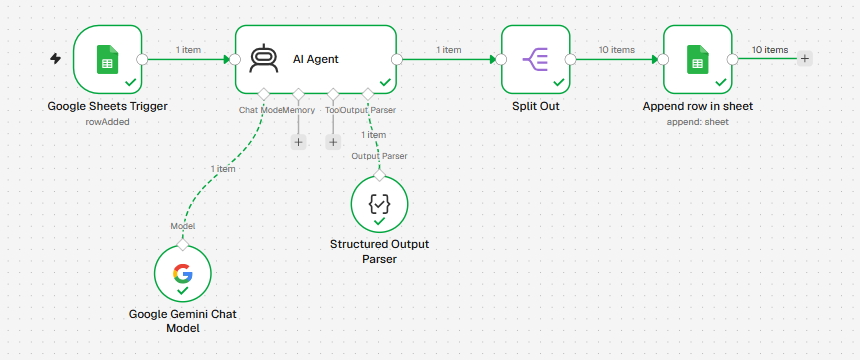
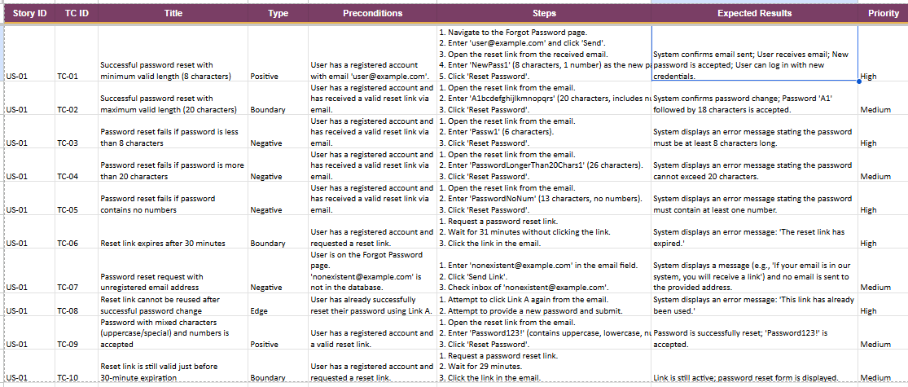

# AI Test Case Generation Agent (n8n + Gemini)

A no-code AI agent that turns user stories into structured test cases. Add a user story to a Google Sheet and the agent writes positive, negative, boundary and edge-case test cases into a second tab within about a minute. Nobody has to copy and paste anything.

**Built with:** n8n (AI Agent node) · Google Gemini (Flash model, free tier) · Google Sheets



---

## The problem

Writing test cases by hand for every user story is slow and repetitive. It's also easy to miss boundary values and edge cases when you're under time pressure. I wanted to see how much of the first draft an AI agent could do reliably, so that my time goes into reviewing and exploratory testing.

## How it works

```
Google Sheets Trigger ──► AI Agent ──► Split Out ──► Google Sheets
 (new row in "Stories")     │            (one item     (append row to
                            │             per test      "TestCases")
                  ┌─────────┴─────────┐   case)
            Gemini Chat Model   Structured Output Parser
```

1. **Trigger:** n8n watches the `Stories` tab and fires when a new row (Story ID, User Story, Acceptance Criteria) is added.
2. **AI Agent:** a system prompt makes the model act as a senior QA engineer. It must write 8–15 test cases covering positive, negative, boundary and edge scenarios, without inventing features that aren't in the story, and list unclear acceptance criteria as open questions.
3. **Structured Output Parser:** forces the answer into a fixed JSON shape (`story_id`, `tc_id`, `title`, `type`, `preconditions`, `steps`, `expected_result`, `priority`) so it always fits the sheet columns.
4. **Split Out:** breaks the list into one item per test case.
5. **Google Sheets:** appends each test case as a row in the `TestCases` tab, mapped column by column.

## Example

**Input (`Stories` tab):**

| Story ID | User Story | Acceptance Criteria |
|---|---|---|
| US-01 | As a user, I want to reset my password via email so I can regain access to my account. | Reset link is sent to registered email; link expires in 30 minutes; new password must be 8–20 characters with one number. |

**Output:** the agent wrote **10 test cases** (2 positive, 4 negative, 3 boundary, 1 edge), each with preconditions, numbered steps, an expected result and a priority. They cover:

- Passwords at the exact limits (8 and 20 characters), below the minimum (6), over the maximum, and with no number
- The reset link just before (29 min) and after (31 min) the 30-minute expiry
- Reusing a link that has already been used
- A reset request for an email that isn't registered

Full output: [`sample-data/test-cases-US-01.csv`](sample-data/test-cases-US-01.csv)



### My review of the output

Treating the AI's work as a first draft, I reviewed it the way I would review a colleague's test cases:

- **Good:** it found the expiry boundary on both sides (29 and 31 minutes) and the link-reuse edge case, which are easy to forget.
- **Weak boundary:** the "over the maximum" case uses a 26-character password. A proper boundary test uses **21** characters, one past the limit.
- **Wrong label:** TC-01 tests exactly 8 characters, so it's really a boundary case, but it's labelled Positive.
- **Assumed behaviour:** TC-07 expects a generic "If your email is in our system…" message. That's good security practice, but the story doesn't say it, so it's an open question for the product owner, not a confirmed expected result.
- **Missing:** an invalid email format, and requesting several links (does the old one stop working?).

The agent saves most of the typing, but a QA engineer still has to check the boundaries and question assumptions.

## What I learned

- **Mapping matters.** The first run created new columns instead of filling mine, because "Map Automatically" only matches exact header names (`story_id` ≠ `Story ID`). Switching to manual column mapping fixed it.
- **AI output isn't deterministic.** Running the same story twice gave different sets: 11 test cases on one run (including an invalid email format case) and 10 on another. That's another reason the output needs a human review.
- **Structured output is essential.** Without a fixed output format, the model's answer can't be written reliably into spreadsheet columns.

## Next steps

- Run it on 10 user stories of different complexity and compare against hand-written test cases (time saved, edge cases caught, mistakes made)
- Write the agent's `open_questions` to a third tab, turning it into a requirement review agent as well
- Add an error notification workflow for failed runs (for example, when the free model quota runs out)

## Try it yourself

1. Create a Google Sheet with two tabs: `Stories` (Story ID, User Story, Acceptance Criteria) and `TestCases` (Story ID, TC ID, Title, Type, Preconditions, Steps, Expected Result, Priority).
2. In n8n, import [`workflow/ai-test-case-agent.json`](workflow/ai-test-case-agent.json) (**⋯ → Import → From file**).
3. Connect your own Google account and a Gemini API key from [Google AI Studio](https://aistudio.google.com), then choose your sheet in both Google Sheets nodes (the exported file has my sheet and credentials removed).
4. Add a story to the `Stories` tab and run the workflow.

> Only use sample or public requirements with the free Gemini tier, since Google may use free-tier prompts to improve its products.
